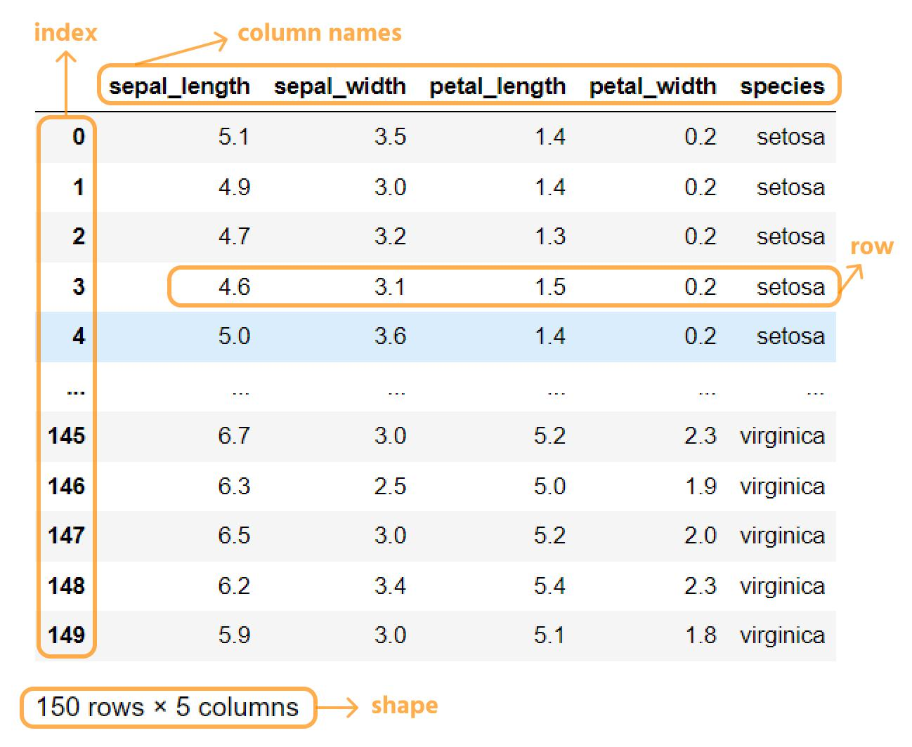

This is the most important concept to understand first.
Pandas has two core data structures:

1. Series
A one-dimensional labeled collection of data, similar to a single column in a table.

2. DataFrame
A two-dimensional labeled data structure with rows and columns, similar to a spreadsheet or SQL table.

For machine learning, you'll frequently work with DataFrames because datasets usually contain multiple features (columns) and many observations (rows).

